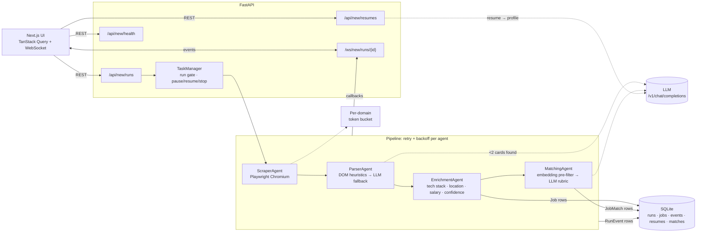
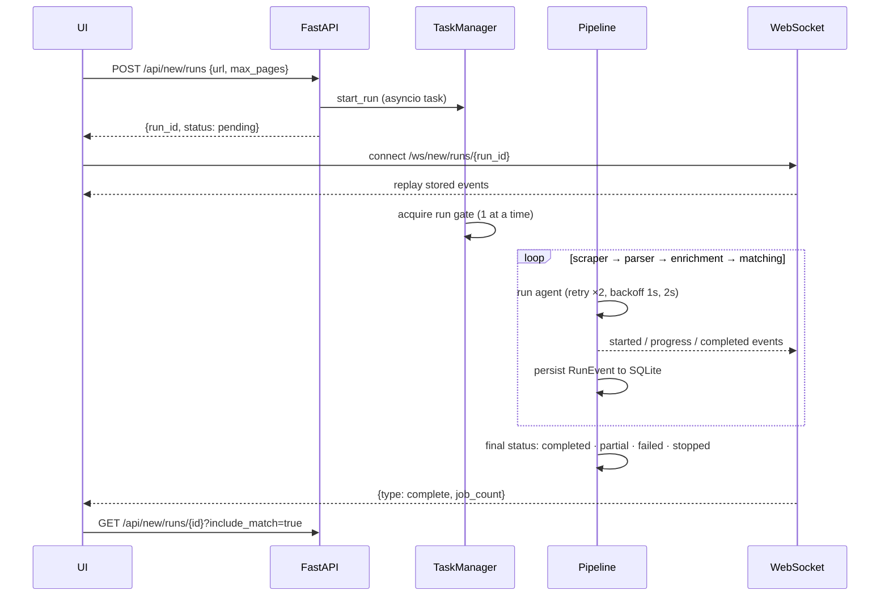

# Multi-Agent Job Extractor

Give it a careers-page URL and (optionally) your resume. Four agents run in sequence: they scrape the site with a headless browser, find the job listings, normalize them into structured records, and score each one against your resume. Each step streams to the UI over a WebSocket as it happens, and you can pause, resume or stop a run at any point.

**Stack:** FastAPI · SQLModel/SQLite · Playwright · BeautifulSoup · sentence-transformers (`all-MiniLM-L6-v2`) · any OpenAI-compatible LLM endpoint (Ollama by default) · Next.js 15 / React 19 / TanStack Query frontend.

## Architecture



### What each agent does

| Agent | Input → output | How |
|---|---|---|
| **ScraperAgent** | URL, `max_pages` → raw HTML pages | Headless Chromium via Playwright (`domcontentloaded`, 30 s timeout). Finds same-host pagination links (`?page=N`, `/page/N`, `/jobs`), deduplicates them, and caps the crawl at `max_pages`. A failed page is logged and skipped instead of failing the run. Supports `file://` URLs for offline testing. |
| **ParserAgent** | HTML → candidate job cards | BeautifulSoup scans `div/li/article/section/tr` blocks for job-ish class/id/text markers and a title containing a role word (engineer, analyst, intern, ...), then picks out the company element. If heuristics find **fewer than 2 cards**, it sends up to 3 pages (8 KB each) to the LLM for structured extraction and merges the results, deduplicating by title. |
| **EnrichmentAgent** | cards → normalized jobs | Matches a 77-term tech taxonomy, infers remote / hybrid / onsite from keyword lists, parses salary ranges (`$120k–150k`, `€60,000 - 80,000`, ...) into min/max/currency, and computes a weighted 0–1 confidence score (LLM-sourced records are discounted ×0.85). Deterministic, no LLM calls. |
| **MatchingAgent** | jobs + resume profile → per-job score, matched/missing skills | Two stages. (1) A cosine-similarity pre-filter using normalized MiniLM embeddings, falling back to Jaccard token overlap. (2) LLM scoring on a 1–10 rubric with JSON output; scores all jobs when there are ≤50, otherwise the top 30. Jobs it doesn't LLM-score get `1 + 9 × similarity`. |

Resume upload (`POST /api/new/resumes`) extracts text from PDF (pypdf) or plain text and asks the LLM for `{skills, years_experience, titles_held, seniority_level}`. If the LLM call fails, a regex/keyword parser fills the same fields.

### Run lifecycle



## Reliability engineering

- **Per-agent retries with exponential backoff.** `Pipeline._retry_agent` runs each agent up to `1 + max_retries` times (default 3 attempts) with `retry_base_delay × 2^attempt` sleeps, and emits each retry as a progress event so it shows up in the UI.
- **Partial results instead of all-or-nothing.** If scraping succeeded but a later stage failed, the run is marked `partial`. If enrichment returns nothing, the parser's raw records are still saved, with confidence 0.1.
- **Graceful LLM degradation.** MatchingAgent health-checks the LLM (`GET /v1/models`) first. If it's unreachable, every job gets a similarity-only score. If one job's LLM response won't parse, it re-prompts once ("previous response was not valid JSON"), then falls back to the embedding estimate for that job. `LLMClient.parse_json` strips markdown fences and preamble before decoding.
- **Non-blocking model load.** The sentence-transformer is loaded in a thread executor in the background with a 15 s timeout, so a cold model never blocks the pipeline. Until it's ready, scoring uses token overlap.
- **Polite scraping.** `DomainRateLimiter` keeps an asyncio-locked token bucket per hostname (1 request/s sustained, burst of 3 by default; `JOBEXTRACT_RATE_LIMIT_PER_DOMAIN`).
- **Cooperative pause / resume / stop.** Agents report progress through an event callback, and while a run is paused that callback blocks on an `asyncio.Condition`, so the run halts at its next progress report. Stop sets a flag that the pipeline checks between stages and before each retry, cancels the task, and marks the run `stopped` in the DB.
- **Overlapping runs are serialized.** An in-process semaphore gate (`InMemoryRunGate`) ensures one pipeline executes at a time; additional runs wait their turn.
- **Event durability.** Every agent event is written to SQLite as a `RunEvent`. A WebSocket that connects late (or reconnects) first gets the full event history, and a run that has already finished sends a terminal message and closes. The frontend reconnects with exponential backoff (1 s doubling, capped at 30 s, 10 attempts) and polls run detail every 2 s while a run is active.
- **Health endpoint** reports LLM reachability, DB reachability (`SELECT 1`), CPU, memory and uptime. `/api/new/health/live` is a cheap liveness probe.

## Caching

| Cache | Scope | Detail |
|---|---|---|
| `EmbeddingCache` | process | Hand-rolled LRU, 2,048 entries, keyed by SHA-256 of the text. Resume and job vectors are cached so repeated or overlapping postings across runs aren't re-encoded. |
| `_keyword_overlap` | process | `functools.lru_cache(maxsize=4096)` on the Jaccard fallback over frozen token sets. |

## API

| Method | Path | Description |
|---|---|---|
| `GET` | `/api/new/health` | LLM + DB reachability, CPU, memory, uptime |
| `GET` | `/api/new/health/live` | Liveness |
| `POST` | `/api/new/resumes` | Upload resume (PDF or text) → parsed profile; becomes the active resume |
| `GET` | `/api/new/resumes/active` | Current active resume profile |
| `DELETE` | `/api/new/resumes/{id}` | Remove resume |
| `POST` | `/api/new/runs` | Start extraction `{url, max_pages, filters?}` |
| `GET` | `/api/new/runs` | Last 50 runs with latest event |
| `GET` | `/api/new/runs/{id}?include_match=true` | Run detail, jobs, events, match scores |
| `POST` | `/api/new/runs/{id}/pause` · `/resume` · `/stop` | Run control |
| `GET` | `/api/new/runs/{id}/export?format=csv\|json` | Export jobs |
| `WS` | `/ws/new/runs/{id}` | Event stream (`event`, `complete`, `error`; send `{"type":"ping"}` for `pong`) |

Interactive docs at `http://localhost:8000/docs`.

## Running locally

**Requirements:** Python 3.12 (`pyproject.toml` requires >=3.12; the Dockerfile uses 3.11), Node.js 18+, and an OpenAI-compatible LLM endpoint for LLM parsing/scoring (optional; the pipeline runs without one). See `OLLAMA_SETUP.md` for Ollama.

### Backend

Run from the repo root. The default SQLite path (`./backend/new/job_extract.db`) is relative to the working directory, and the packages (`app`, `new`) live under `backend/`.

```bash
python3 -m venv .venv && source .venv/bin/activate
pip install -r requirements.txt httpx
playwright install chromium

PYTHONPATH=backend uvicorn app.main:app --reload --port 8000
```

### LLM (optional)

```bash
ollama serve
ollama pull mistral
```

### Frontend

```bash
cd frontend-next
npm install
npm run dev      # http://localhost:3000
```

### Offline end-to-end check

`backend/new/sample_jobs.html` is a fixture page. This script runs scraper → parser → enrichment → persistence against it via `file://` and prints the stored jobs and events:

```bash
PYTHONPATH=backend python backend/new/test_e2e.py
```

You can also paste `file:///absolute/path/to/backend/new/sample_jobs.html` into the UI as the run URL.

### Configuration

Settings come from `backend/new/config.py` (pydantic-settings, prefix `JOBEXTRACT_`, `.env` supported).

| Variable | Default | Purpose |
|---|---|---|
| `JOBEXTRACT_LLM_BASE_URL` | `http://localhost:11434` | Base URL; the client appends `/v1/chat/completions` and `/v1/models` |
| `JOBEXTRACT_LLM_MODEL` | `mistral` | Model name |
| `GROQ_API_KEY` | unset | Sent as a Bearer token when set (Groq or any hosted OpenAI-compatible API) |
| `JOBEXTRACT_DATABASE_URL` | `sqlite:///./backend/new/job_extract.db` | SQLAlchemy URL |
| `JOBEXTRACT_MAX_RETRIES` / `JOBEXTRACT_RETRY_BASE_DELAY` | `2` / `1.0` | Agent retry policy |
| `JOBEXTRACT_RATE_LIMIT_PER_DOMAIN` | `1` | Scraper requests per second per host |
| `JOBEXTRACT_PLAYWRIGHT_HEADLESS` | `true` | Headless browser |
| `FRONTEND_URL` | unset | Extra CORS origin besides `http://localhost:3000` |

### Deployment config

- `fly.toml`: app `job-extract-api`, region `sin`, 1 shared CPU / 1 GB, SQLite on a mounted volume at `/data`, HTTP health check on `/api/new/health`, scale-to-zero, Groq `llama3-8b-8192` as the LLM.
- `docker-compose.yml`: API plus an `ollama/ollama` container.
- `.github/workflows/ci.yml`: installs dependencies on Python 3.12 and runs pytest on push/PR to `main`.

## Project layout

```
backend/
  app/main.py              FastAPI app, CORS, error handlers, router wiring
  new/
    pipeline.py            orchestration, retries, pause/stop, persistence
    tasks.py               TaskManager (scheduling, run gate, run control)
    agents/                scraper, parser, enrichment, matching (+ BaseAgent)
    api/                   runs, resumes, health, ws
    llm_client.py          OpenAI-compatible client + tolerant JSON extraction
    rate_limiter.py        per-domain token bucket; Redis sliding-window LLM limiter
    run_queue.py           Redis FIFO run queue; in-memory run gate
    models.py, db.py       SQLModel tables
    sample_jobs.html       offline fixture
    test_e2e.py            fixture-based pipeline check
frontend-next/             Next.js UI (agent live stream, results grid, sidebar)
```

## Limitations and next steps

- **Redis layer is written but not connected.** `rate_limiter.py` has a Redis sorted-set sliding-window LLM limiter and token-usage counter, and `run_queue.py` has an `LPUSH`/`BRPOP` FIFO run queue with a worker loop. Nothing creates a Redis client or calls `TaskManager.set_queue`, `LLMClient` doesn't call the limiter, and no Redis library is in `requirements.txt`. In practice runs go through the in-memory semaphore gate.
- **Frontend API module missing from git.** Components import `@/lib/api`, but the repo's `.gitignore` has a bare `lib/` rule (meant for Python builds), so `frontend-next/src/lib/api.ts` was never committed. A fresh clone of the frontend won't build until that file is restored.
- **CI points at a test directory that doesn't exist** (`backend/tests/`). The only test is the script-style `backend/new/test_e2e.py`.
- **Deployment configs don't match the layout.** `fly.toml` and `docker-compose.yml` build `backend/` as the Docker context, but the Dockerfile and `requirements.txt` sit at the repo root. The Fly LLM base URL already ends in `/v1`, and the client adds another `/v1`. Compose sets `DATABASE_URL` where the app reads `JOBEXTRACT_DATABASE_URL`.
- `httpx` (used by `LLMClient`) isn't pinned in `requirements.txt`, hence the explicit install above.
- Heuristic parsing is tuned to conventional job-card markup. Heavily client-rendered boards and sites behind bot protection may need the LLM fallback or site-specific selectors.
- Word uploads pass the content-type check but are decoded as plain text. Only PDF and `.txt` parse properly.
- `backend/scoring_weights.yaml` (field weights for a weighted resume score) isn't read by the current matching code.
- Embedding and similarity caches live in process memory and reset on restart.

## License

MIT
